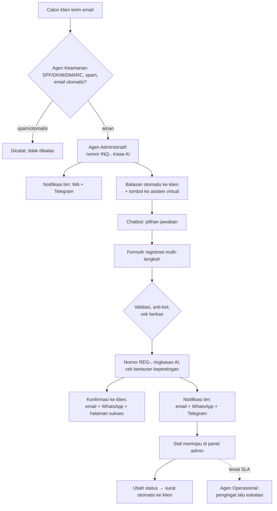
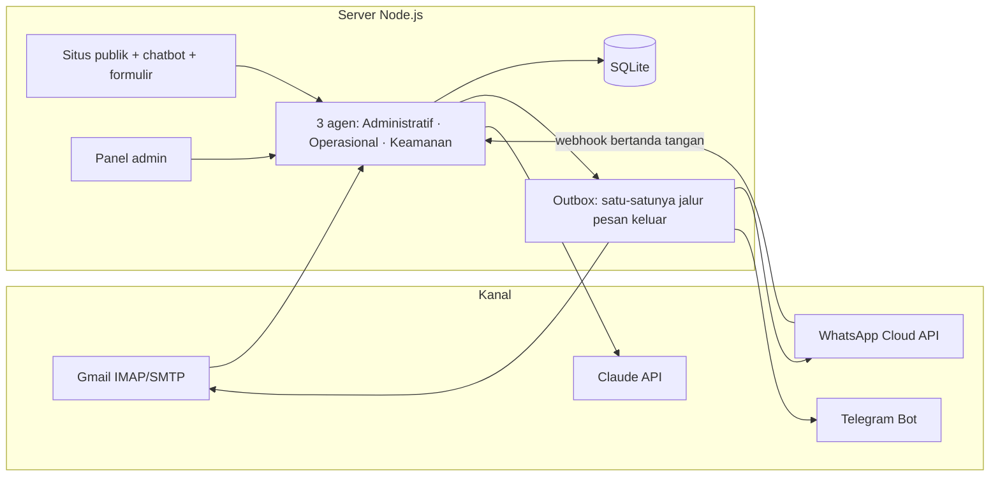

# PRD Tahap 1 — Kantor Virtual: Penerimaan Calon Klien

| | |
|---|---|
| **Produk** | Kantor virtual Kantor Hukum Bhaga & Rekan (`kantorbhaga.id`) |
| **Tahap** | 1 — Pengecekan calon klien & penerimaan kebutuhan |
| **Status dokumen** | Draf untuk direview sebelum Tahap 2 |
| **Tanggal** | 17 Oktober 2026 |
| **Kode** | Branch `claude/law-office-ai-agent-c8ckgb` |

> Cara mereview: beri tanda ✅ / ✏️ / ❌ pada setiap butir di **§12 Keputusan yang perlu direview**, dan tambahkan catatan di bagian mana pun yang tidak sesuai kebutuhan kantor. Bagian bertanda **[Konfirmasi]** adalah asumsi yang belum pernah disetujui secara eksplisit.

---

## 1. Ringkasan

Sistem ini menerima calon klien secara otomatis, dari email pertama sampai kebutuhan hukumnya tercatat lengkap dan siap ditinjau tim. Tiga agen AI mandiri berbagi tugas: **Administratif** (alur klien & surat), **Operasional** (kotak masuk, pengingat, SLA, laporan), dan **Keamanan** (penyaringan email, anti-bot, cek benturan kepentingan, akses).

Alur inti Tahap 1:

1. Calon klien mengirim email ke kantor.
2. Tim langsung mendapat notifikasi di WhatsApp dan Telegram.
3. Calon klien dibalas otomatis dan diarahkan ke asisten virtual (chatbot) dengan pilihan jawaban.
4. Calon klien mengisi formulir registrasi terstruktur.
5. Setelah dikirim, notifikasi masuk ke email, WhatsApp, dan Telegram, untuk klien maupun tim.

Tahap ini **belum** menangani perjanjian jasa, penagihan, maupun manajemen perkara.

## 2. Latar belakang & masalah

- Permintaan konsultasi datang tidak terstruktur (email bebas), sehingga advokat harus bolak-balik bertanya untuk mendapatkan informasi dasar.
- Respons pertama sering terlambat di luar jam kerja, dan calon klien tidak tahu status permintaannya.
- Pemeriksaan benturan kepentingan dilakukan manual dan mudah terlewat.
- Persyaratan data calon klien bisa berubah, jadi formulir tidak boleh "dikunci" di kode.

## 3. Tujuan & ukuran keberhasilan

| Tujuan | Ukuran (target usulan) **[Konfirmasi]** |
|---|---|
| Respons pertama instan | Balasan otomatis < 2 menit sejak email diterima (polling IMAP 60 detik) |
| Kebutuhan klien lengkap sebelum konsultasi | ≥ 80% registrasi tanpa status *Perlu informasi tambahan* |
| Tindak lanjut tepat waktu | ≥ 90% registrasi ditinjau dalam SLA 24 jam kerja |
| Kesan profesional | Semua pesan memakai template resmi kantor, bernomor registrasi, dengan langkah selanjutnya yang jelas |
| Konflik terdeteksi dini | Setiap registrasi otomatis dicek terhadap daftar pihak |
| Admin mandiri | Formulir, chatbot, dan template bisa diubah tanpa developer |

## 4. Ruang lingkup

**Termasuk Tahap 1**

- Penerimaan email (Gmail/IMAP) dan balasan otomatis yang aman (anti-loop, anti-spam).
- Notifikasi tim via WhatsApp Cloud API dan grup Telegram.
- Chatbot berpilihan jawaban di situs, formulir registrasi multi-langkah, halaman sukses, halaman status.
- Panel admin: registrasi, email masuk, status, penugasan, catatan, editor formulir/chatbot/template, pengguna, log notifikasi, audit.
- Ringkasan & triase dengan AI (Claude), cek benturan kepentingan, pengingat SLA, ringkasan harian.
- Lingkungan staging aman, CI, dan deploy otomatis.

**Di luar Tahap 1** (kandidat Tahap 2, lihat §13)

- Penjadwalan konsultasi ke kalender, pembayaran/invoice, perjanjian jasa & tanda tangan elektronik.
- Portal klien dengan login, manajemen perkara & dokumen pascapenerimaan.
- Chatbot AI percakapan bebas (saat ini pohon pilihan, demi akurasi & kepatuhan).

## 5. Pengguna & peran

| Pengguna | Kebutuhan | Akses |
|---|---|---|
| **Calon klien** (perorangan/badan usaha) | Menyampaikan masalah dengan mudah, tahu langkah berikutnya & status | Situs publik, email, WhatsApp |
| **Admin kantor** | Mengatur formulir, chatbot, template, akun staf, kanal | Panel admin, peran `admin` |
| **Staf / advokat** | Meninjau registrasi, mengubah status, menulis catatan, menerima tugas | Panel admin, peran `staf` |
| **Tim (grup)** | Pemberitahuan cepat | Grup Telegram, WhatsApp staf |

## 6. Alur pengguna

Calon klien juga bisa langsung membuka situs tanpa email lebih dulu; alurnya mulai dari langkah chatbot.

### Status registrasi

| Status | Arti | Surat ke klien |
|---|---|---|
| `baru` | Baru diterima | Konfirmasi otomatis saat submit |
| `ditinjau` | Sedang ditinjau | Opsional |
| `perlu_info` | Perlu informasi tambahan | Ya — staf **wajib** menulis informasi yang diminta |
| `dijadwalkan` | Konsultasi dijadwalkan | Ya — staf **wajib** menulis jadwal |
| `diterima` | Diterima sebagai klien | Ya |
| `ditolak` | Tidak dapat ditangani | Ya (sopan, tanpa alasan sensitif) |
| `arsip` | Diarsipkan | Tidak |

## 7. Kebutuhan fungsional

Status: ✅ selesai & teruji · 🟡 selesai, belum diuji dengan kanal sungguhan · ⬜ belum

### 7.1 Agen Administratif

| ID | Kebutuhan | Status |
|---|---|---|
| ADM-1 | Email masuk dicatat dengan nomor `INQ-YYYY-00001`, termasuk triase AI (bidang hukum, urgensi, ringkasan) | ✅ |
| ADM-2 | Balasan otomatis profesional dengan tombol ke asisten virtual & formulir (data email terisi otomatis) | ✅ |
| ADM-3 | Chatbot berpilihan jawaban (6 simpul: sambutan, perkara baru, persiapan, layanan, proses & biaya, kontak) + cek status dengan nomor registrasi & email | ✅ |
| ADM-4 | Formulir 5 bagian + tinjau & kirim; draf tersimpan di peramban; bidang bersyarat | ✅ |
| ADM-5 | Nomor registrasi `REG-YYYY-00001`, halaman sukses dengan langkah selanjutnya & tautan status | ✅ |
| ADM-6 | Konfirmasi ke klien (email + WhatsApp) dan notifikasi tim (email + WhatsApp + Telegram) | ✅ simulasi · 🟡 kanal nyata |
| ADM-7 | Perubahan status mengirim surat dari template; status yang sama ditolak | ✅ |
| ADM-8 | Penugasan registrasi ke staf + notifikasi ke staf tersebut; catatan internal | ✅ |
| ADM-9 | Halaman status publik dengan linimasa (tanpa login, memakai tautan bertoken) | ✅ |

**Isi formulir bawaan** (bisa diubah admin):

1. *Data Pemohon* — jenis pendaftar, nama, badan usaha & jabatan (bersyarat), email, WhatsApp, kota, cara dihubungi.
2. *Kebutuhan Hukum* — bidang hukum, layanan, kronologi, harapan, tahap perkara, urgensi, tenggat.
3. *Pihak Terkait* — pihak lawan, pernah ditangani advokat lain.
4. *Jadwal Konsultasi & Dokumen* — bentuk & waktu konsultasi, dokumen pendukung, sumber informasi.
5. *Persetujuan* — PDP (UU 27/2022), belum ada hubungan advokat–klien, pernyataan kebenaran data.

Bidang yang dipakai agen ditandai dengan **peran** (`client_name`, `client_email`, `client_phone`, `matter_type`, `urgency`, `opposing_party`, `description`), bukan ID bidang. Admin bebas mengganti label & urutan tanpa merusak otomasi.

### 7.2 Agen Operasional

| ID | Kebutuhan | Status |
|---|---|---|
| OPS-1 | Membaca kotak masuk Gmail via IMAP tiap 60 detik | ✅ simulasi · 🟡 Gmail nyata |
| OPS-2 | Antrean pesan keluar (*outbox*): simpan dulu, kirim, coba ulang hingga 6 kali dengan jeda bertambah (maks. 4 jam) | ✅ |
| OPS-3 | SLA 24 jam kerja (Senin–Jumat 09.00–17.00 WIB): pengingat saat jatuh tempo, eskalasi (dengan email) bila tetap belum ditinjau; lebih cepat untuk perkara mendesak | ✅ |
| OPS-4 | Satu pengingat sopan ke calon klien yang belum mengisi formulir setelah 48 jam | ✅ |
| OPS-5 | Ringkasan harian ke Telegram pukul 08.00 | ✅ |
| OPS-6 | WhatsApp: teks bebas dalam jendela 24 jam, template `notifikasi_kantor` di luar jendela; balasan WA klien diteruskan ke grup Telegram & riwayat registrasi | ✅ simulasi · 🟡 Meta nyata |

### 7.3 Agen Keamanan

| ID | Kebutuhan | Status |
|---|---|---|
| SEC-1 | Penyaringan email: SPF/DKIM/DMARC, indikasi phishing, lampiran berbahaya, pemalsuan domain kantor | ✅ |
| SEC-2 | Tidak pernah membalas otomatis email otomatis/massal/spam; batas balasan per pengirim (cegah loop) | ✅ |
| SEC-3 | Anti-bot formulir: honeypot + waktu pengisian minimum; pembatasan laju (submit 6 per 10 menit per IP, login, cek status) | ✅ |
| SEC-4 | Unggahan: PDF/PNG/JPG/DOCX saja, dicek dari isi berkas (bukan ekstensi), PDF ber-JavaScript ditolak, maks. 10 MB × 5 berkas | ✅ |
| SEC-5 | Cek benturan kepentingan: nama pemohon & pihak lawan dibandingkan dengan daftar pihak (normalisasi nama + kemiripan) | ✅ |
| SEC-6 | Akun per staf, sandi scrypt, sesi bertanda tangan, cabut sesi, wajib ganti sandi sementara, peran admin/staf | ✅ |
| SEC-7 | CSP ketat (tanpa skrip inline), header keamanan, proteksi CSRF, log audit semua aksi admin | ✅ |

### 7.4 Panel admin & konfigurasi

| ID | Kebutuhan | Status |
|---|---|---|
| CFG-1 | Editor formulir (tambah/ubah bagian & bidang, tipe, wajib, bersyarat, peran) dengan validasi skema | ✅ |
| CFG-2 | Editor chatbot & template pesan (email/WA/Telegram) dengan pratinjau | ✅ |
| CFG-3 | Semua pengaturan **berversi**; registrasi lama tetap dibaca dengan versi formulir saat dikirim | ✅ |
| CFG-4 | Pengaturan kantor: nama, alamat, kontak, jam kerja, SLA, warna, logo, tanda tangan | ✅ |
| CFG-5 | Manajemen pengguna (admin saja), Akun Saya, log notifikasi, audit, alat uji kanal & simulasi email | ✅ |

### 7.5 AI (Claude)

| ID | Kebutuhan | Status |
|---|---|---|
| AI-1 | Triase email masuk & ringkasan registrasi untuk tim (output JSON terstruktur) | ✅ diuji dengan server tiruan · 🟡 API nyata |
| AI-2 | Sistem tetap berjalan normal bila AI nonaktif atau gagal | ✅ |
| AI-3 | AI **tidak** pernah mengirim pesan ke klien secara langsung; hanya membantu tim | ✅ (desain) |

## 8. Kebutuhan non-fungsional

| Area | Ketentuan |
|---|---|
| Privasi (UU PDP) | Persetujuan eksplisit di formulir; rahasia hanya di `.env`; log publik tidak memuat data klien |
| Keandalan | Pesan keluar tidak hilang saat penyedia gagal (outbox + retry); cadangan harian otomatis (simpan 14 terakhir) |
| Keamanan staging | Pesan hanya ke staf/grup/daftar izin; lainnya berstatus *blocked*; situs dilindungi sandi, tidak diindeks |
| Aksesibilitas | Navigasi keyboard, `aria-current` pada langkah formulir, menghormati *reduced motion*, tampil baik di ponsel |
| Bahasa | Semua teks untuk pengguna dalam Bahasa Indonesia formal |
| Kinerja | Satu server kecil (1 vCPU/1 GB) cukup; tanpa database terpisah (SQLite) |

## 9. Desain antarmuka

- Tema **Meridian Blue** dari 21st.dev (biru `#3b608f`, aksen terakota `#b8694a`, judul serif).
- Komponen 21st.dev yang di-port: **Suggestions** (chip jawaban chatbot) dan **Segmented Progress Pill Stepper** (langkah formulir).
- Di-port ke CSS/JS biasa: tanpa React/Tailwind, tanpa font eksternal (CSP tetap ketat). Warna dapat diubah admin.

## 10. Arsitektur & teknologi

- Node.js ≥ 22.13, Express 5, SQLite bawaan Node, tanpa build step.
- Docker + Caddy (HTTPS otomatis) untuk staging; GitHub Actions untuk CI (test + build image) dan deploy.
- 20 skenario test otomatis (alur email, registrasi, validasi, keamanan, konflik, status, template, akun & peran, WhatsApp, AI, staging).

## 11. Status saat ini

| Komponen | Status |
|---|---|
| Aplikasi Tahap 1 (semua fitur §7) | ✅ Selesai, 20/20 test lulus, CI hijau |
| Berjalan lokal di laptop | ✅ Terverifikasi |
| Desain baru (21st.dev) | ✅ Terpasang |
| Identitas kantor (Bhaga & Rekan, kantorbhaga.id) | ✅ Diperbarui (bawaan & data lama otomatis) |
| Kanal nyata (Gmail, WhatsApp Cloud API, Telegram, Claude API) | 🟡 Kode siap; kredensial belum diisi & belum diuji ujung-ke-ujung |
| Staging di VPS | ⬜ **Tertunda** — butuh VPS (Cloudflare tidak menyediakan VPS) dan DNS `staging.kantorbhaga.id`. Jalur deploy tanpa SSH (auto-update) sudah siap |
| Template WhatsApp `notifikasi_kantor` | ⬜ Perlu diajukan & disetujui Meta |
| UAT dengan tim kantor | ⬜ Menunggu staging (daftar uji di `deploy/DEPLOY-STAGING.md` §6) |
| Kode di branch utama (`master`) | ⬜ Masih di branch kerja; perlu Pull Request & merge |

## 12. Keputusan yang perlu direview

| # | Keputusan / asumsi saat ini | ✅/✏️/❌ & catatan |
|---|---|---|
| 1 | SLA respons **24 jam kerja**, jam kerja Senin–Jumat 09.00–17.00 WIB | |
| 2 | Chatbot berupa **pilihan jawaban** (bukan AI bebas) demi akurasi & menghindari kesan memberi nasihat hukum | |
| 3 | AI hanya untuk ringkasan & triase internal, **tidak** membalas klien | |
| 4 | Isi formulir bawaan (§7.1) sudah sesuai kebutuhan observasi tim | |
| 5 | Persetujuan PDP menyebut pemrosesan oleh penyedia teknologi (email, WhatsApp, AI) | |
| 6 | Status `ditolak` mengirim surat sopan tanpa menyebut alasan | |
| 7 | Satu kali pengingat ke calon klien yang belum mengisi formulir (setelah 48 jam) | |
| 8 | Ringkasan harian ke Telegram pukul 08.00 | |
| 9 | Hosting: satu VPS kecil (Ubuntu, Docker) — penyedia & lokasi belum dipilih | |
| 10 | Batas unggahan 10 MB × 5 berkas, format PDF/JPG/PNG/DOCX | |
| 11 | Desain Meridian Blue dari 21st.dev untuk situs & panel admin | |

## 13. Risiko & mitigasi

| Risiko | Mitigasi |
|---|---|
| Balasan otomatis memicu loop / membalas spam | Deteksi email otomatis & massal, batas balasan per pengirim |
| Pesan WhatsApp ditolak di luar jendela 24 jam | Mode `auto`: template resmi di luar jendela |
| Klien mengira formulir = nasihat hukum | Pernyataan eksplisit di formulir, footer, dan surat |
| Kebocoran data di log/CI publik | Log publik tanpa data klien; rahasia hanya di GitHub Secrets/`.env` |
| Akses tidak sah ke panel admin | Akun per staf, peran, pembatasan laju login, audit |
| Staging mengirim ke klien sungguhan | Daftar izin penerima, status *blocked*, awalan `[STAGING]` |
| Repositori publik | Tidak ada rahasia di repo; deploy staging tidak menjalankan kode GitHub di VPS |

## 14. Usulan awal Tahap 2 (untuk didiskusikan, belum dibangun)

Prasyarat: staging aktif dan UAT Tahap 1 lulus.

1. **Penjadwalan konsultasi** — slot dari Google Calendar, klien memilih jadwal, undangan & pengingat otomatis.
2. **Perjanjian jasa & e-signature** — surat penawaran/engagement letter dari template, tanda tangan elektronik.
3. **Penagihan awal** — invoice biaya konsultasi & tautan pembayaran.
4. **Portal klien** — login klien untuk unggah dokumen tambahan & melihat perkembangan.
5. **Penerimaan menjadi perkara** — registrasi `diterima` dikonversi ke berkas perkara dengan penanggung jawab.
6. **Laporan** — dasbor volume, sumber klien, waktu respons, tingkat konversi.

## 15. Lampiran — peta berkas

| Bagian | Lokasi |
|---|---|
| Agen | `src/agents/administrative.js`, `operational.js`, `security.js` |
| Kanal | `src/channels/email.js`, `whatsapp.js`, `telegram.js`; outbox `src/outbox.js` |
| AI | `src/ai/claude.js` |
| Konfigurasi bawaan | `config/defaults/office.json`, `form.json`, `chatbot.json`, `templates.json` |
| Situs & panel | `public/`, `public/admin/` |
| Test | `test/` (`npm test`) |
| Deploy & staging | `deploy/`, `.github/workflows/`, panduan `deploy/DEPLOY-STAGING.md` |
| Panduan umum | `README.md` |
